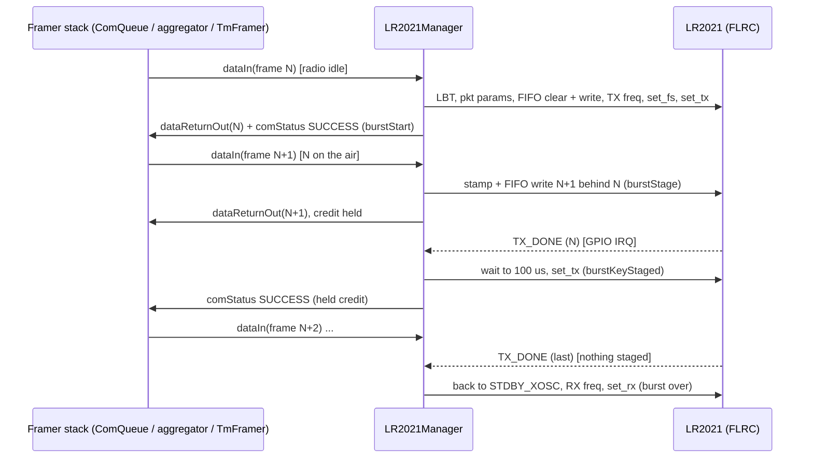

# FLRC Burst Downlink

`LR2021_FLRC_BURST` lets the FLRC (S-band) radio send downlink TM frames back to back:
while one frame is on the air the next one is already in the radio TX FIFO, and it is keyed
as soon as the radio reports `TX_DONE`, without the credit round trip through the framer
stack and without returning to RX between frames. **It is on by default**
(`LR2021_FLRC_BURST 1`); with it off the radio behaves as before the feature was added.

The on-air format does not change: every frame is still a separate FLRC packet with its own
preamble, syncword and header, carrying one 223-byte CCSDS TM frame. The ground receiver
needs no change.

The scheme follows Semtech's FLRC burst TX (`smtc_rac_lib/smtc_rac/smtc_rac_flrc_burst.c` in
USP v1.2.1, used by FLRP-BURST). For the component architecture see the
[LR2021Manager SDD](sdd.md).

## Configuration (`LR2021Cfg.hpp`)

| Define | Burst on (default) | Burst off | Meaning |
|---|---|---|---|
| `LR2021_FLRC_BURST` | 1 | 0 | Feature switch; the next three follow it unless set explicitly |
| `LR2021_FLRC_PA_RAMP` | `RAMP_272_US` | `RAMP_128_US` | FLRC PA ramp time |
| `LR2021_FLRC_BURST_KEY_DELAY_US` | 100 | — | Spin from handling `TX_DONE` to keying the next frame |
| `LR2021_FLRC_FALLBACK_FS` | 1 | 0 | Fallback after TX/RX: FS (synthesizer stays locked) or STDBY_XOSC |

Burst on also writes Genmod ShapeCfg DblRate (register `0x00F30904`, bit 8) in `flrcInit()`:
set below 2 Mb/s, cleared at 2.08 / 2.6 Mb/s, as Semtech does after its FLRC setup.

Independent of the switch, `radioInit()` configures the 1024-byte TX/RX FIFOs
(`lr20xx_radio_fifo_configure_1024_byte_*`, 1020 B TX / 1000 B RX usable; valid with the
patch RAM loaded just before). A burst frame may be up to `BURST_FRAME_MAX` = 510 B, so the
frame on the air and the staged one fit in the TX FIFO together.

Only frames routed to a radio in FLRC mode take part; the UHF (FSK) radio, UART, SDR and host
routes are unchanged.

## How it works

- **One frame staged, never dropped.** The credit of the staged frame is held until it is
  keyed, so the framer can never hand over more than the FIFO slot can take. A frame that
  cannot be staged (different length) waits in `pendingFramer` like a frame held back by a
  beacon.
- **Key = `set_tx` only.** The staged frame is already in the FIFO and has the burst's
  length, so no FIFO write and no `set_pkt_params` happen at `TX_DONE` (Semtech re-issues
  `set_pkt_params` only when the length changes).
- **Ends by itself.** A burst lasts as long as the next frame is already staged at
  `TX_DONE`; otherwise the radio goes back to RX immediately.
- **First frame** of a burst uses the normal path (LBT, retune to the TX channel, `set_fs`);
  frames inside a burst skip LBT, the RX re-arm and both retunes.
- **Failed FIFO write** while staging: the FIFO is not cleared (that would cut the frame on
  the air); the frame is dropped (`TxFrameDropped`), the burst ends at `TX_DONE`, which
  grants the held credit, and the next `flrcTx` clears the FIFO.
- **Aborts** (`setMode`, TX test, BER test, TX timeout): `burstAbort` drops the frame on
  the air and the staged one (`TxFrameDropped` event each), and grants the held credit so
  the downlink flow stays open (a plain TX failure closes it; a burst abort does not).
- **Beacon** frames routed to the FLRC radio are not part of a burst: they are sent only
  when the slot is completely idle.
- **Keyed on `TX_DONE`, not `TX_TIMESTAMP`.** Semtech's code keys on `TX_TIMESTAMP` (last
  bit), but the datasheet says that IRQ is "only to be used for time-stamping, not for
  changing mode or re-configuring the device".

## Interframe

Interframe = time on the air from the last bit of a packet to the first preamble bit of the
next (Semtech's definition). It contains the PA ramp-down, the idle time and the PA ramp-up.
Semtech pairs it with the ramp time (`flrp_configuration.h`: "190 is the minimal interframe,
pa-ramp-time is applied for up & down"; FLRP guidelines: 128 µs ↔ ≥ 400 µs, 272 µs ↔
≥ 700 µs for CR 3/4 near sensitivity).

Measured from IQ recordings (ramp 272 µs, 2.08 and 2.6 Mb/s):

| Key delay | Interframe p1 / p50 / p99 |
|---|---|
| 0 µs | 698 / 701 / 788 µs |
| **100 µs** | **797 / 801 / 843 µs** |

Estimated split at 100 µs: PA ramps 2 × 272 = 544 µs, chip fixed part ≈ 94 µs (Semtech's
190 µs minimum at 48 µs ramp, minus both ramps), key delay 100 µs, `TX_DONE` path
(GPIO IRQ → work queue → component thread → status read → `set_tx`) ≈ 63 µs. The
interframe does not depend on the bit rate, so its share of the cycle grows with it
(46 % at 2.6 Mb/s).

## Constraints found on this hardware

Bench: RadioTestDeployment (nucleo, RY42F module) → LimeSDR + `lr2021-ground` FLRC receiver,
cable with ~40 dB attenuation; IQ recorded with a bare SoapySDR loop and decoded offline.
The ground receiver correlates on a 61-symbol template with ≤ 4 errors: the last 8
preamble bits + the 21-bit pattern + the 32-bit syncword.

**Current (patch RAM, 1024-byte FIFO, 2026-11-03):**

1. **A FIFO write during TX is fine.** Writing the next frame behind the one on the air
   gives correct packets (all sequence numbers present in every IQ recording).
2. **PA ramp 272 µs + key delay 100 µs.** With shorter settings the chip started modulating
   before the PA had ramped up on the frames keyed inside a burst, so their preamble was
   corrupt (first frames of a burst were clean). The corrupt window lasts a roughly fixed
   time, so it costs more bits at higher rates:

   | Rate | Ramp | Key delay | Corrupt header bits (> 10 % errors) | Header start vs. power-up | 61/4 template decodes |
   |---|---|---|---|---|---|
   | 1.04 Mb/s | 128 µs | 500 µs | 0–35 (≈ 34 µs, preamble ~50 %) | 42 µs early | 68.1 % |
   | 2.08 Mb/s | 272 µs | 0 | 0–33 (≈ 16 µs) | 29 µs early | 92.3 % |
   | 2.08 Mb/s | 272 µs | 100 µs | none | 36 µs after | 100 % |
   | 2.6 Mb/s | 272 µs | 100 µs | none | 31 µs after | 100 % |

   The datasheet says "In Tx mode, BUSY goes low when the PA has ramped-up and transmission of
   preamble starts"; the clean settings match that. In all cases the syncword itself was
   error-free (a 32-symbol syncword-only template decoded 100 %). The datasheet calls the
   first 1–4 bytes the "AGC preamble" and gives a minimum receiver preamble of 16 bits
   (≤ 1.3 Mb/s), 20 bits (2.08 Mb/s) and 24 bits (2.6 Mb/s) at 2.4 GHz.
3. **No burst: PA ramp 128 µs.** 1000/1000 at all 8 rates; 96 µs lost preambles (2.6 Mb/s:
   35 % with the full-header template).

**History (driver 1.3.4, no patch RAM, default 256-byte FIFO, 2026-10-30):**

1. The TX FIFO held 255 bytes, so two 223-byte frames never fit together.
2. A TX FIFO write while the chip transmitted left the next packet without preamble /
   syncword / header (~2410 bits on the air instead of ~2550), so frames were staged in RAM
   and written into the FIFO after `TX_DONE`, followed by `set_pkt_params`.
3. That needed the 128 µs ramp (96 µs lost ~half the frames) and ≥ ~450 µs from `TX_DONE`
   to `set_tx` (~400 µs lost ~7 %); the final RAM-staging build used 500 µs and still left
   the preamble of the staged frames corrupt at ≥ 1.04 Mb/s.

## Throughput

RadioTestDeployment `Vspc.ComSpeedTest` TX flow (208-byte space packets = 202-byte F´ packets,
one per 223-byte TM frame), FLRC CR 3/4, counted on the ground with
`scripts/radiotest/comtest_yamcs.py down`; steady-state values.

| Rate | No burst (ramp 128) | Burst | Burst gain |
|---|---|---|---|
| 650 kb/s | 185 frames/s, 0.299 Mb/s | 212 frames/s, 0.343 Mb/s ¹ | +15 % |
| 1.04 Mb/s | 254 frames/s, 0.410 Mb/s | 322 frames/s, 0.521 Mb/s ² | +27 % |
| 1.3 Mb/s | 286 frames/s, 0.462 Mb/s | 381 frames/s, 0.616 Mb/s ² | +33 % |
| 2.08 Mb/s | 353 frames/s, 0.570 Mb/s | 500 frames/s, 0.807 Mb/s | +42 % |
| 2.6 Mb/s | 384 frames/s, 0.620 Mb/s | 566 frames/s, 0.916 Mb/s | +48 % |

Mb/s = F´ packet bytes. ¹ ramp 128 µs, key delay 500 µs (before the ramp change).
² key delay 0. 2.08 / 2.6 Mb/s: ramp 272 µs, key delay 100 µs, 0 lost of 22 835 / 60 081
frames. No-burst runs: 0 lost.

Outside the airtime a frame costs ≈ 1.55 ms without burst and ≈ 0.70–0.80 ms with it. In a
burst the framer stack (~0.57 ms per frame, measured over USB) runs during the previous
frame's airtime and is not the limit: an 8 s IQ recording at 2.6 Mb/s had 4529 frames in a
single burst. The limit is airtime + interframe per 223-byte packet.

## Comparison with Semtech FLRP-BURST

FLRP-BURST is in USP v1.2.1 (`protocols/smtc_flrc_protocol`,
`examples/main_examples/flrp_api_example`, `doc/FLRP_*.md`); its burst TX is
`smtc_rac_flrc_burst.c` (the stand-alone FLRC burst application was removed in v1.2.1).

| | Semtech FLRP-BURST | This burst |
|---|---|---|
| Scope | Complete file-transfer protocol: LoRa wake-up / sync, FLRC REQ/ACK, burst, BURST ACK bitmap, retransmission of missing packets | Radio layer only: back-to-back keying of existing CCSDS TM frames |
| Peer | Must run FLRP too | Unchanged ground (any FLRC receiver) |
| Packet | Fixed 300 B (CR 1/2) / 400 B, own framing, CRC or AES-CMAC MIC | 223 B CCSDS TM frame, FECF; one frame per packet |
| Chip set-up | Patch RAM, 1024-byte TX/RX FIFO | Same |
| Feeding the FIFO | Two packets pre-loaded; the next one written while the current one transmits | Next frame written while the current one transmits |
| Key | `set_tx` on TX_TIMESTAMP IRQ (`set_pkt_params` only if the length changes) | `set_tx` on `TX_DONE` GPIO IRQ after ≥ 100 µs |
| Fallback | FS, `set_fs` before the first key | Same |
| PA ramp / interframe | Default 272 µs ↔ 700 µs (CR 3/4); 128 ↔ 400; min 48 ↔ 200 | 272 µs ↔ ~800 µs |
| DblRate (ShapeCfg bit 8) | Below 2 Mb/s | Same |
| LBT | Once before the burst (optional) | Once, on the first frame of a burst |
| Burst length | ≤ 255 packets and ≤ 400 ms per burst | Unbounded: as long as frames keep coming |
| Reliability | ACK bitmap + selective retransmission | None at this layer (as without burst) |
| Gross burst rate at 2.6 Mb/s, CR 3/4 | ~1.37 Mb/s (272/700), ~1.73 Mb/s (48/200) | 1.01 Mb/s of TM frames |

The gap to FLRP's 1.37 Mb/s at the same ramp is the packet size: ~800 µs of interframe per
223-byte packet instead of per 400-byte packet. Two TM frames per FLRC packet (446 B, fits
`BURST_FRAME_MAX`) would give ≈ 1.33 Mb/s at 2.6 Mb/s; not implemented (needs the ground
receiver to accept 446-byte packets and split them).

## Ground receiver (lr2021-ground)

- At 2.6 Mb/s (20.8 Msps) the live receiver lost frames in bursts while the board sent all
  of them (verified by IQ); the cause was the Python TX source holding the GIL in many small
  `work()` calls. `flowgraphs/flrc_station.py` sets `set_min_noutput_items(1 << 15)` on it:
  downlink 0 lost of 60 081 frames, S-band uplink 3 lost of 2000 (11 without the change).
- The 61/4 sync template needs the last 8 preamble bits clean; with the settings above they
  are.

## Impact on the S-band TC uplink

The S-band link is half duplex (TX 2250 MHz / RX 2270 MHz on one LR2021).

- **No reception during a burst.** Between burst frames the radio stays on the TX side (FS);
  it re-arms RX only after the last frame. A TC sent during a burst is not received. A
  continuous file downlink is one burst.
- **Not new in practice.** Without the burst the radio was in RX for only ~1 ms between
  frames, shorter than one TC frame, so a TC overlapping a busy downlink was lost as well.
  The ground SDR modem also holds its TX while it sees our syncwords (link-aware hold, 20 ms),
  so it waits for the downlink to go quiet in both cases.
- **No in-burst LBT.** Only the first frame of a burst checks for a peer frame; a peer that
  starts transmitting mid-burst is not detected.
- **TC latency** on S-band is bounded by the burst length (a whole file transfer). If a TC
  must get through during long downloads (e.g. a cancel), cap the burst and insert an RX
  window (Semtech caps a burst at 400 ms); not implemented. The UHF uplink is unaffected.
- **After a burst** the radio is back in RX right after the last `TX_DONE`, as after any
  single frame.
